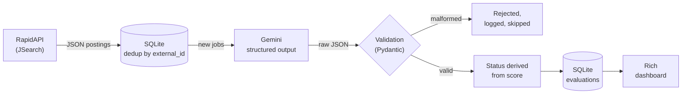

# ApplyPylot

[](https://github.com/Wadekone/ApplyPylot/actions/workflows/ci.yml)

ApplyPylot is a local CLI that pulls job postings from an API, scores each one with an LLM against a target profile (Senior Delivery Lead / PMO / Operations), and ranks them in a terminal dashboard. I built it because most of my job-search time went into reading postings that were junior, on-site, or not delivery roles at all. It does the first-pass triage so I only read the roles worth reading.



## Quick start (about 5 minutes, no API keys)

Requires Python 3.11+ (CI uses 3.12). The `python3` that ships with macOS is 3.9, so install a newer one first: `brew install python@3.12`.

```bash
git clone https://github.com/Wadekone/ApplyPylot.git && cd ApplyPylot
python3.12 -m venv .venv && source .venv/bin/activate
pip install -r requirements-dev.txt

python cli.py demo     # full pipeline on 10 bundled postings, mock LLM
python eval.py         # offline eval, writes docs/eval-report-offline.md
pytest -q              # unit tests
```

`demo` runs the real ingestion, dedup, validation, storage and dashboard code. Only the LLM call is replaced by a mock with preset scores. It uses a throwaway database.

<!-- SCREENSHOT: dashboard. Save as docs/screenshots/dashboard.png, then replace this comment with:
 -->

**With real data:** `cp .env.example .env`, add `GEMINI_API_KEY` and `RAPIDAPI_KEY`, then:

```bash
python cli.py run                                   # fetch → evaluate → dashboard
python cli.py dashboard --min-score 6 --status PASS --search fintech
python cli.py show 42                               # requirements, gaps, apply link
```

## Evals

`eval.py` runs 10 hand-written postings with an expected outcome (3 PASS, 3 BORDERLINE, 4 FAIL) through parse → validate → store, then 13 guardrail checks.

| Check | What it verifies |
|---|---|
| Schema compliance | Every answer parses and matches `JobEvaluationSchema` |
| Output validation | Score in 0–10, status agrees with score, non-empty summary and requirements, unchanged after a SQLite round-trip |
| Status accuracy | Status matches the expected band: exact, one band off, or two bands off |
| Guardrails | Bad JSON, out-of-range score, unknown status, missing field, blank summary and wrong type are rejected. A contradictory status is corrected. Duplicate `external_id` is skipped |

**Thresholds** (`config.py`): **PASS** ≥ 7.5 · **BORDERLINE** 5.0–7.4 · **FAIL** < 5.0. A `--live` run fails on any PASS↔FAIL miss or on fewer than 70% exact matches.

**Latest run:** offline, mock LLM ([full report](docs/eval-report-offline.md))

| Metric | Result |
|---|---|
| Schema + validation compliance | 10/10 |
| Guardrail & storage tests | 13/13 |
| Status accuracy | 10/10, preset by the mock, so not a model measurement |
| LLM answers corrected from score | 0 |

The live Gemini run (`python eval.py --live`, which writes `docs/eval-report.md`) has not been run yet. Until it is, the model's real accuracy is unmeasured.

<!-- SCREENSHOT: eval output. Save as docs/screenshots/eval.png, then replace this comment with:
 -->

## Design decisions

The full context for each is in [docs/decisions.md](docs/decisions.md).

- **Status is derived from the score.** The model returns both, and they can disagree (PASS at 4.0). A ranking needs one source of truth, so code recomputes the status from the score using thresholds defined once, and counts every correction.
- **Malformed output is rejected.** A wrong score silently moves a job up or down the list, while a skipped job is visible and can be retried. Anything that fails parsing or validation is logged and skipped, and the batch continues.
- **Dedup by `external_id`.** The same posting returns on every fetch. A `UNIQUE` constraint on the source's job ID, with `INSERT OR IGNORE`, makes re-fetching safe and puts the guarantee in the database rather than in code.

## Known limitations and next steps

| Limitation | Next step |
|---|---|
| Live accuracy is unmeasured | Run `eval.py --live` and commit the report; grow the set beyond 10 samples |
| Dedup misses the same role posted under different source IDs | Add a secondary match on normalized title + company |
| Target profile is hard-coded in the prompt | Load the profile (or a CV) from a config file |
| One source, no retry or backoff on API errors | Add retries with backoff, then a second source |
| Mock scores are fixtures, not a model | Add recorded real Gemini answers as regression fixtures |

## How it was built

I defined the problem, the scoring logic, the quality rules and the evals. The code was written with [Claude Code](https://claude.com/claude-code).
